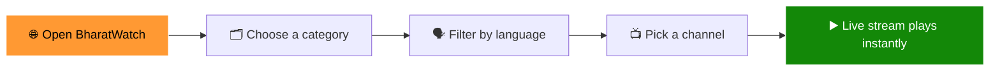

<div align="center">


<a href="https://bharat-watch-taupe.vercel.app">
  
</a>

<br/>

<a href="https://bharat-watch-taupe.vercel.app"></a>
&nbsp;
<a href="https://bharat-watch-taupe.vercel.app"></a>
&nbsp;


<br/><br/>


</div>

<br/>

---

## 📺 About

**BharatWatch** is a free, fast and clean live TV streaming web app built for India's diverse audience. Instead of hunting across dozens of websites and apps, you get **60+ Indian live channels in a single, distraction-free interface**, covering news, movies, sports and entertainment in every major Indian language.

No account. No paywall. Open the site, pick a channel, and watch.

> **🔗 Live:** [bharat-watch-taupe.vercel.app](https://bharat-watch-taupe.vercel.app)

<br/>

## 🖼️ Preview

<div align="center">

<a href="https://bharat-watch-taupe.vercel.app">
  
</a>

<sub>Live snapshot of the deployed app. Click to open.</sub>

</div>

<br/>

## ✨ Features

| | Feature | What you get |
|---|---|---|
| 📡 | **Live streaming** | Watch 60+ Indian TV channels live, right in your browser |
| 🗂️ | **Category browsing** | Jump between **News**, **Movies**, **Sports** and **Entertainment** |
| 🗣️ | **Multi-language** | Hindi, Tamil, Telugu, Bengali, Malayalam, Kannada, Marathi, Punjabi and English |
| 🆓 | **Completely free** | No sign-up, no subscription, no ads wall |
| 📱 | **Responsive design** | Works on phones, tablets, laptops and big screens |
| ⚡ | **Fast and lightweight** | Instant load, edge-hosted on Vercel's global network |

<br/>

## 🌐 Languages and Categories

<div align="center">

| Categories | Languages |
|:---:|:---:|
| 📰 News | 🇮🇳 Hindi |
| 🎬 Movies | Tamil · Telugu · Malayalam · Kannada |
| 🏏 Sports | Bengali · Marathi · Punjabi |
| 🎭 Entertainment | English |

</div>

<br/>

## 🧭 How It Works



<br/>

## 🛠️ Tech Stack

<div align="center">


</div>

<br/>

## 🚀 Getting Started

Run BharatWatch locally in under a minute.

```bash
# 1. Clone the repository
git clone https://github.com/mitrasayak623-crypto/bharat-watch.git

# 2. Move into the project
cd bharat-watch

# 3. Start a local server
npx serve .
```

Then open the local URL shown in your terminal (usually `http://localhost:3000`).

> 💡 You can also open `index.html` directly in your browser.

<br/>

## ☁️ Deployment

The project is deployed on **Vercel**, and every push to the main branch redeploys automatically.

[](https://vercel.com/new/clone?repository-url=https://github.com/mitrasayak623-crypto/bharat-watch)

<br/>

## 🗺️ Roadmap

- [x] Live channels across News, Movies, Sports and Entertainment
- [x] Multi-language channel coverage
- [x] Responsive layout and Vercel deployment
- [ ] Channel search with instant results
- [ ] Favourites and recently watched
- [ ] Picture-in-Picture and fullscreen shortcuts
- [ ] Installable PWA experience
- [ ] Light and dark theme toggle
- [ ] More regional channels

<br/>

## 🤝 Contributing

Contributions, issues and feature requests are welcome. Hacktoberfest contributors are especially welcome. 🎃

1. **Fork** the repository
2. **Create** your branch: `git checkout -b feature/amazing-feature`
3. **Commit** your changes: `git commit -m "feat: add amazing feature"`
4. **Push** to the branch: `git push origin feature/amazing-feature`
5. **Open** a Pull Request

If you find a channel that is not working, please open an issue with the channel name and category.

<br/>

## ⚖️ Disclaimer

BharatWatch does **not host, store or upload any video content**. All streams are provided by their respective broadcasters and third-party public sources. All channel names, logos and trademarks belong to their respective owners. This project is built for **educational and personal use only**. If you are a rights holder and want a channel removed, please open an issue and it will be taken down promptly.

<br/>

## 📄 License

Distributed under the **MIT License**. See [`LICENSE`](LICENSE) for details.

<br/>

## 👨‍💻 Author

<div align="center">

**Sayak Mitra**
B.Tech CSE (AI/ML) · Bosscoder School of Technology, Bengaluru
*Solving DSA, building with Java and the web, aiming for FAANG.*

<br/>

<a href="https://www.linkedin.com/in/sayak-mitra-884251380/"></a>
<a href="https://github.com/mitrasayak623-crypto"></a>
<a href="https://leetcode.com/u/Sayakmitra/"></a>

<br/><br/>

### ⭐ If you enjoy BharatWatch, give it a star. It really helps!

<a href="https://bharat-watch-taupe.vercel.app"></a>

</div>


